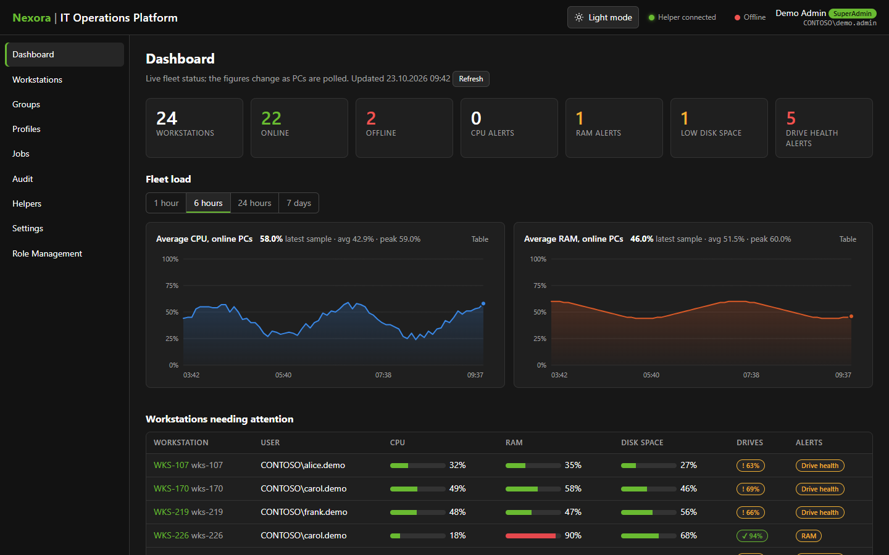
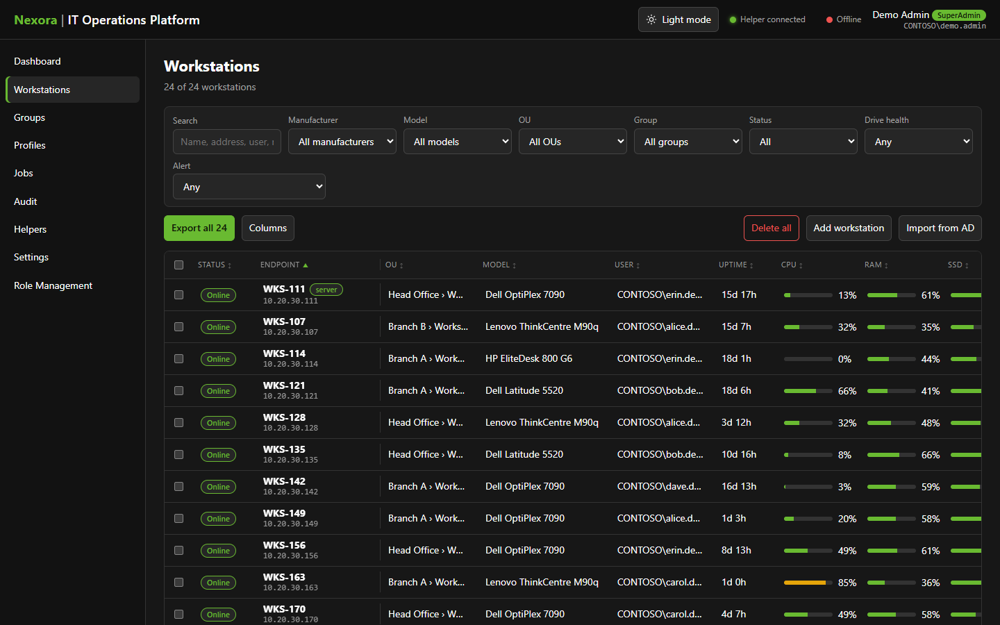
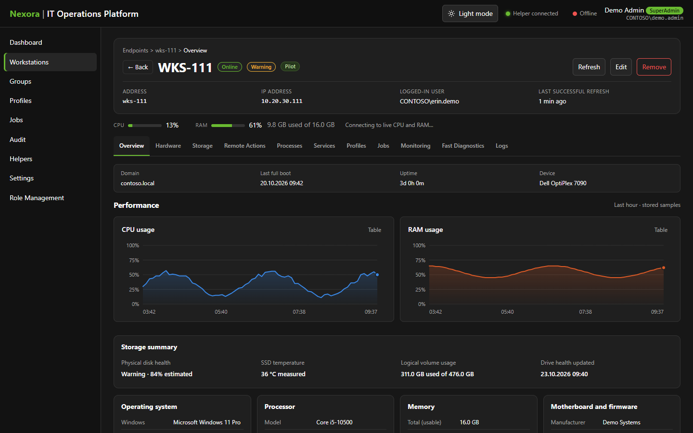
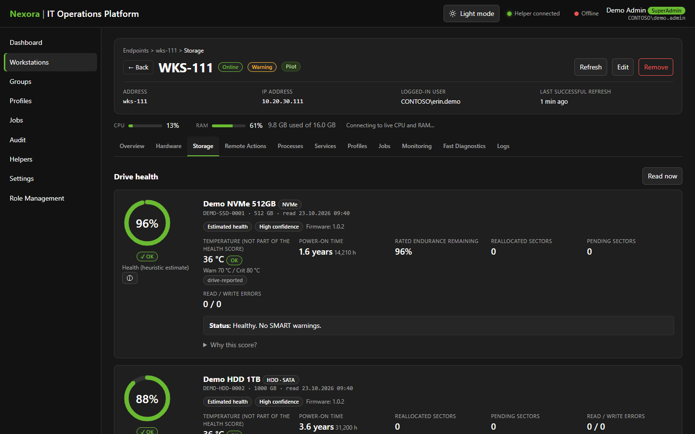
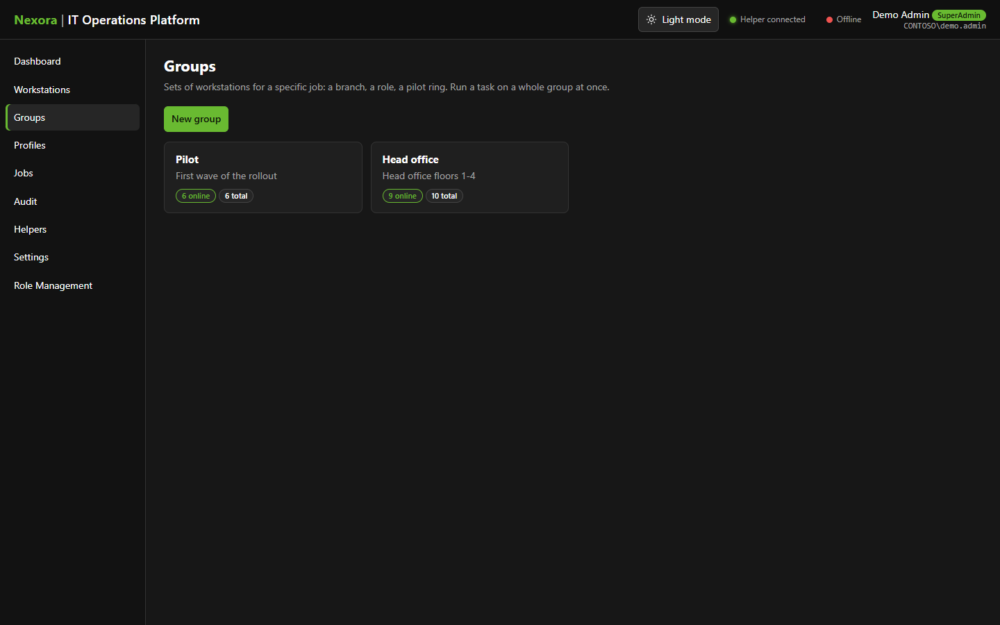
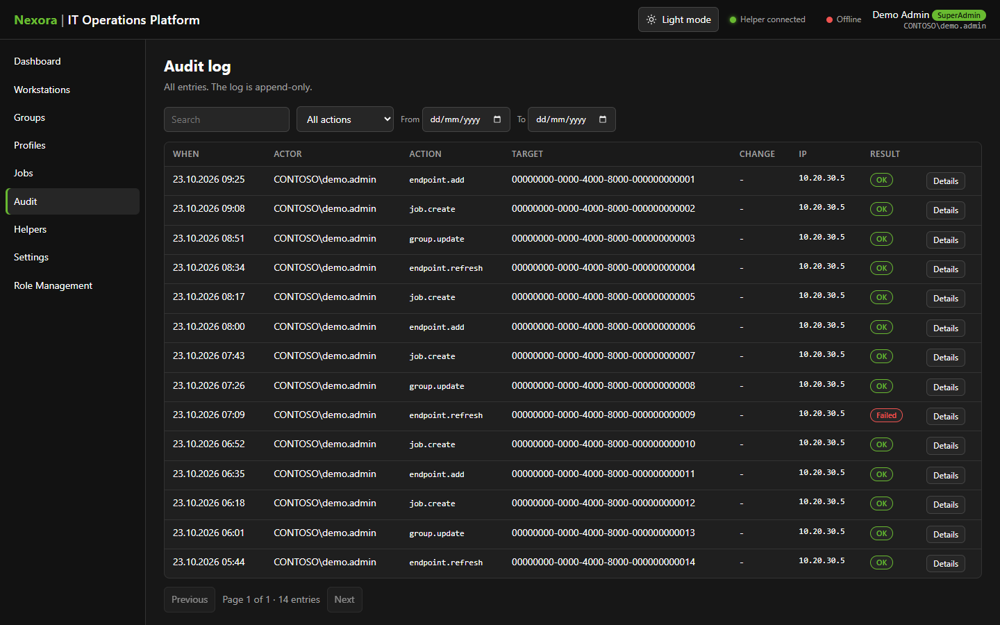

# Nexora | IT Operations Platform

Endpoint monitoring and remote operations for an IT service desk: a live fleet dashboard, per-workstation hardware and
drive-health views, audited remote actions, and role-based access, all on Windows Integrated Authentication over plain HTTP.

> **All data in this repository is synthetic.** Company (`Contoso`), hostnames (`WKS-###`), users, SIDs, IP addresses and
> serial numbers are made up. The screenshots below were rendered from generated demo data, not from a real fleet.

## Screenshots

| | |
|---|---|
|  |  |
| **Dashboard**: fleet status, load history, workstations needing attention | **Workstations**: filter, sort, export, bulk group updates |
|  |  |
| **Workstation overview**: OS, CPU, memory, live load | **Drive health**: SMART-based score, temperature, endurance |
|  |  |
| **Groups**: organize PCs for filtering and bulk tasks | **Audit log**: every action attributed to the initiating operator |

## Highlights

- **Agentless collection** over WMI/CIM: CPU, RAM, volumes, hardware inventory, SMART and NVMe health. No agents on endpoints.
- **Operator identity on every action.** Remote actions run under the initiating operator's own token through `Nexora.Helper`
  and are audited as that operator. The server identity never performs privileged endpoint actions.
- **Roles enforced server-side**: Viewer, Operator, Admin, SuperAdmin (matched by SID, never by name).
- **Drive health scoring** with explainable reasons, separate temperature tracking and stable identity by serial number.
- **Deterministic diagnostics** (feature-flagged): collectors plus a rule engine for symptoms such as a slow PC or a frozen Outlook.
- **Tamper-evident audit log**: database triggers reject `UPDATE`, `DELETE` and `TRUNCATE`.
- **Security-first defaults**: credential operations disabled (`Features:CredentialOps=false`), CSRF/origin checks, rate limiting,
  signed jobs.

## Architecture

```
 Browser (React SPA) ──HTTP, Windows SSO──►  HTTP.sys ──► Nexora.Api (ASP.NET Core, .NET 10)
        ▲  SignalR (live)                                   │  controllers · SignalR hubs · monitoring service
        │                                                   ├─► PostgreSQL (users, requests, audit, endpoints, jobs)
 Operator PC                                                ├─► WMI/CIM read-only polling of endpoints
 Nexora.Helper ◄── signed job (SignalR, operator's own SSO) ┘
   └─ runs the action with the operator's own token
```

| Project | Purpose |
|---|---|
| `Nexora.Domain` | Entities and enums. |
| `Nexora.Contracts` | Job protocol shared with the helper. |
| `Nexora.Application` | Use cases, authorization rules, diagnostics, DTOs. |
| `Nexora.Infrastructure` | EF Core + Npgsql, WMI collector, read-only AD lookup. |
| `Nexora.Api` | HTTP.sys host, controllers, SignalR hubs, monitoring service. |
| `Nexora.Web` | React + TypeScript + Vite + TanStack Query. |
| `Nexora.Helper` | Runs jobs in an operator's own session with that operator's token. |

## Stack

.NET 10 / ASP.NET Core on HTTP.sys · PostgreSQL · SignalR · React + TypeScript (strict) · PowerShell 5.1 endpoint scripts.

## Build and test

Requirements: Windows 11, .NET 10 SDK, Node 20+.

```powershell
dotnet build Nexora.sln
dotnet test Nexora.sln          # no network, AD or database needed (in-memory provider, fake Windows auth)

cd src/Nexora.Web
npm ci
npm test                        # vitest
npm run check                   # typecheck + eslint + tests
```

## Regenerate the screenshots

The UI runs against an in-process API of generated data; it never contacts a real server.

```powershell
cd src/Nexora.Web
npm ci
npm run demo:screenshots        # writes docs/images/*.png (Chrome; set NEXORA_BROWSER=msedge for Edge)
```

## Running it

Installing on a host (URL ACL, firewall rule, private PostgreSQL cluster, service scripts) is covered in the
[full guide](docs/GUIDE.md) and [operations notes](docs/operations-v1.md). In short:

```powershell
.\scripts\nexora.ps1 -Action Build
.\scripts\nexora.ps1 -Action Install    # once, elevated
.\scripts\nexora.ps1 -Action DbInit     # once
.\scripts\nexora.ps1 -Action Start      # then open http://<host>:5090
```

Set `Nexora:SuperAdmin:Sid` in `appsettings.json` to your own SID and `Nexora:AccessGroup` to your AD group.
The sample values are placeholders.

## Design constraints

Plain HTTP only, Windows Integrated Auth only, no Active Directory changes, no WinRM / PowerShell remoting, endpoint scripts
compatible with PowerShell 5.1 and free of external modules. See [CLAUDE.md](CLAUDE.md) and `docs/adr/` for the reasoning.

## Documentation

- [Full guide](docs/GUIDE.md): installation, configuration, roles, workstations, remote actions, troubleshooting
- [Operations](docs/operations-v1.md) · [Security and release](docs/security-release-v1.md) · [Storage health](docs/storage-health-v5.md)
- [Architecture decisions](docs/adr/) · [Repo map](docs/REPO_MAP.md)

## License

No license has been chosen yet. Until one is added, all rights are reserved by the author.
